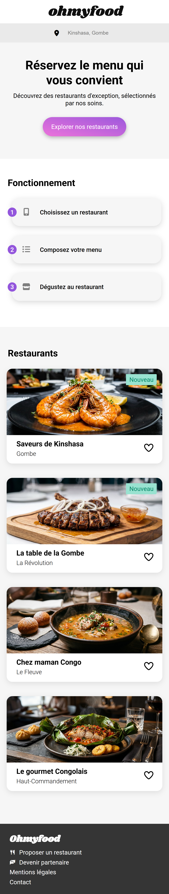
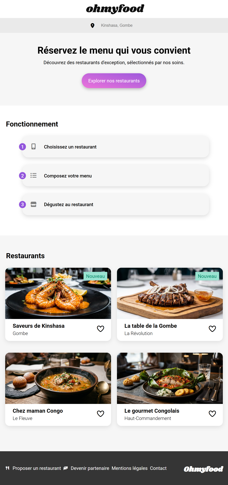

# 🍽️ Ohmyfood - La haute gastronomie congolaise

[](https://developer.mozilla.org/fr/docs/Web/HTML)
[](https://developer.mozilla.org/fr/docs/Web/CSS)
[](https://sass-lang.com/)
[](https://git-scm.com/)

**Ohmyfood** est une plateforme de réservation de restaurants gastronomiques, pensée **mobile first**. Ce projet a été réalisé dans le cadre de ma formation **Développeur Web** chez OpenClassrooms, et adapté à la richesse culinaire de la **République Démocratique du Congo 🇨🇩**.

🌐 **Voir le site en ligne** : [https://m-bu-y.github.io/Ohmyfood/](https://m-bu-y.github.io/Ohmyfood/)

---

## 📋 Contexte du projet

L'objectif était d'intégrer une maquette Figma en HTML et SASS, en mettant l'accent sur :

- **Le mobile first** : conception d'abord pour smartphones, puis adaptation tablette/desktop.
- **Les animations CSS** : loader, apparition des cartes, icônes "cœur", etc.
- **L'architecture SASS** : code modulaire, maintenable et scalable.

---

## 📸 Aperçu du projet

| Version Mobile (Mobile First) | Version Tablette |
| :---: | :---: |
|  |  |  

---

## 🛠️ Technologies utilisées

| Catégorie | Technologies |
| :--- | :--- |
| **Front-end** | HTML5, CSS3, SASS (SCSS) |
| **Méthodologie** | Mobile First, BEM (Block Element Modifier) |
| **Outils** | Git, GitHub, VS Code, Live Sass Compiler |
| **Conception** | Figma |

---

## 📁 Architecture SASS

Le projet utilise une architecture modulaire (inspirée du pattern 7-1) pour organiser le code :

sass/
├── abstracts/ # Variables, mixins
├── base/ # Reset, typographie,
├── components/ # Boutons, cartes, heart-style, animations
├── layout/ # footer, header, loader
├── pages/ # Styles spécifiques aux pages
└── theme/ # Mode sombre (prefers-color-scheme)

---

## ✨ Fonctionnalités clés

- ✅ **Mobile First** : Conçu d'abord pour les petits écrans.
- ✅ **Animations CSS** : Loader, apparition progressive des cartes, icônes "cœur".
- ✅ **Mode sombre automatique** : Détection des préférences utilisateur (`prefers-color-scheme`).
- ✅ **Architecture SASS** : Code modulaire et maintenable.
- ✅ **Responsive Design** : Adapté aux mobiles, tablettes et ordinateurs.

---

## 🚀 Visualiser le projet en local

```bash
# Cloner le dépôt
git clone git@github.com:M-bu-y/Ohmyfood.git

Ouvrez ensuite le fichier index.html dans votre navigateur (double-clic ou "Ouvrir avec").

    Aucun serveur ou installation complexe n'est requis : c'est du pur HTML/CSS statique.


---

## 👤 Auteur

**Emmanuel M. Bamanya (M-bu-y)**

[](https://github.com/M-bu-y)
[](https://www.linkedin.com/in/emmanuel-mbuyi)

---

⭐ *Projet réalisé dans le cadre de la formation OpenClassrooms - Toute ressemblance avec un site existant serait purement fortuite.*


